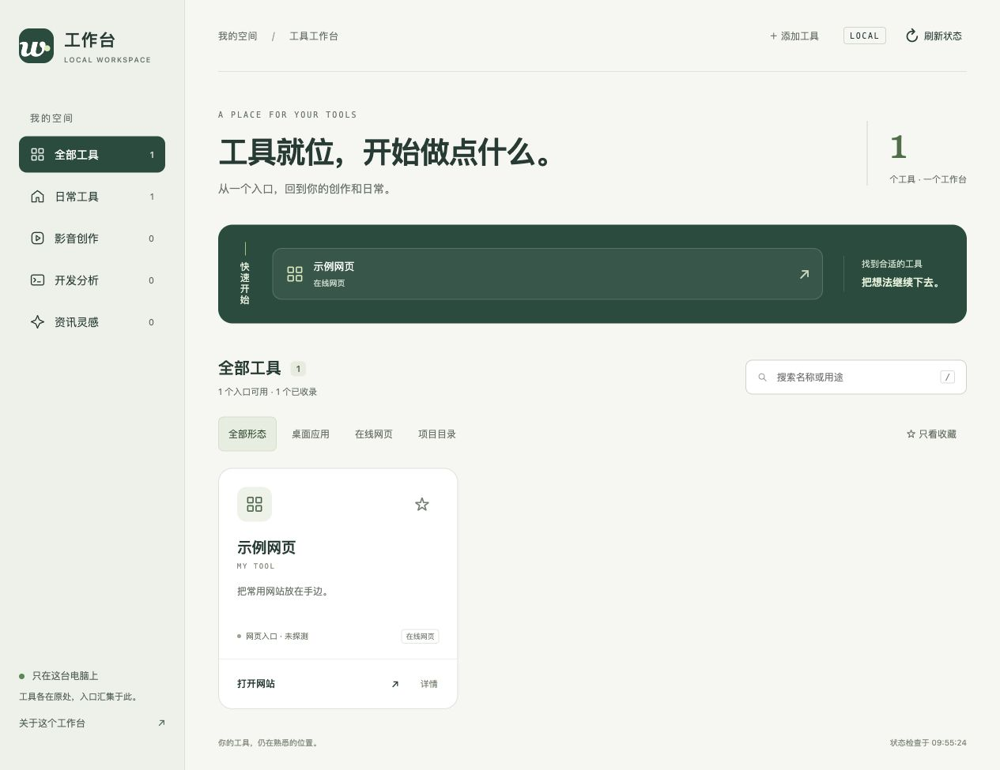

# 本地工作台 · Local Workbench

把常用应用、网页和项目目录放在一个本地页面里。工具留在原位置，工作台负责整理和打开。

不需要 Node.js、npm、数据库、Docker 或 API Key。运行时只依赖 Python 标准库；前端资源全部本地提供。



## 快速开始

安装 Python 3.10 或更新版本，然后下载本仓库 ZIP 并解压，或运行：

```sh
git clone https://github.com/Tyler9169/local-workbench.git
cd local-workbench
python3 server.py
```

浏览器会自动打开 **http://127.0.0.1:43120**。点击「添加工具」，填写名称、类型、路径或网址即可。初次启动是空工作台，不附带作者的个人工具和路径。

- macOS：也可双击 `start.command`；如果没有执行权限，先运行 `chmod +x start.command`。
- Windows：安装 Python 后双击 `start.bat`，或运行 `py -3 server.py`。
- Linux 桌面：运行 `./start.sh`；打开目录需要系统提供 `xdg-open`。
- 停止：在启动终端按 **Ctrl+C**。关闭浏览器页面不会停止服务。

端口被占用时：

```sh
python3 server.py --port 43125
```

不自动打开浏览器：`python3 server.py --no-open`。不要同时启动多个进程共用同一配置目录。

## 可以做什么

- 网页内添加、编辑、移除入口；移除入口不删除原应用或文件。
- 分类、关键词搜索、浏览器本地收藏；快速入口优先显示收藏。
- 检查本地目录是否存在；移动或断开磁盘后保留入口并提示修正路径。
- macOS `.app` 应用、任意本地目录、HTTPS 网页、本机 HTTP 服务链接。
- 支持 `~/Documents/...`，不需要写死用户名。

**边界：** 本地服务必须自行启动；工作台不会执行自定义 shell 命令、安装工具或复制工具本体。Windows/Linux 当前支持网页和目录，不支持添加可执行程序。网页入口不做联网健康检查。“位置可用”仅表示目录存在，不代表对应软件的所有功能正常。

## 数据与迁移

工具清单保存于 `data/tools.json`，首次保存入口时自动创建。数据目录已被 `.gitignore` 排除；不要将个人工具配置提交到公开仓库。收藏保存在当前浏览器的 localStorage，不会跟随清单迁移；更换端口或浏览器会使用独立收藏。

备份/迁移时复制 `data/tools.json`，再通过页面调整新电脑上的路径。也可参考 `tools.example.json` 手工配置；支持 `url`、`folder`、`app` 三种类型。编号须唯一，分类为日常工具、影音创作、开发分析、资讯灵感之一。最多 200 个入口。

自定义数据目录（例如升级时保持数据独立）：

```sh
WORKBENCH_DATA_DIR="$HOME/.local-workbench" python3 server.py
```

Windows PowerShell：

```powershell
$env:WORKBENCH_DATA_DIR = "$HOME\.local-workbench"
py -3 server.py
```

升级时替换程序文件，保留自己的 `data` 目录。配置损坏时页面显示错误，写操作不会覆盖损坏原件；请恢复备份或修复 JSON。

## 本机访问与隐私

仅监听 `127.0.0.1`，并校验 Host、Origin 和自定义请求头。静态资源使用固定白名单，配置文件不能通过 HTTP 下载。启动操作只接受已登记入口，不接收命令或额外参数；所有页面文本均转义。

不提供遥测或云端同步。点击网页入口会通过默认浏览器访问该网站。网址不允许账号密码、查询参数和片段，避免把带令牌的登录链接写进配置。

这是单用户桌面工具，没有远程鉴权。**不要通过反向代理、公网隧道或修改监听地址暴露到网络。** 不建议 Docker 部署：容器无法直接打开宿主机应用和文件管理器。

## 开发与验证

```sh
python3 -m unittest discover -s tests -v
# 可选：需要 Node.js，仅用于开发语法检查
node --check dist/app.js
```

`server.py` 负责配置、校验及系统打开；`dist/` 是无需构建的 HTML/CSS/JavaScript。GitHub Actions 在 macOS、Windows、Linux 上运行配置/API 测试；真实系统打开行为仍需在对应桌面环境验证。

本机已验证 macOS 的页面增删改与目录打开流程。跨平台 CI 结果以仓库 Actions 为准。

## 许可

MIT。欢迎按自己的工作流修改与分享。
